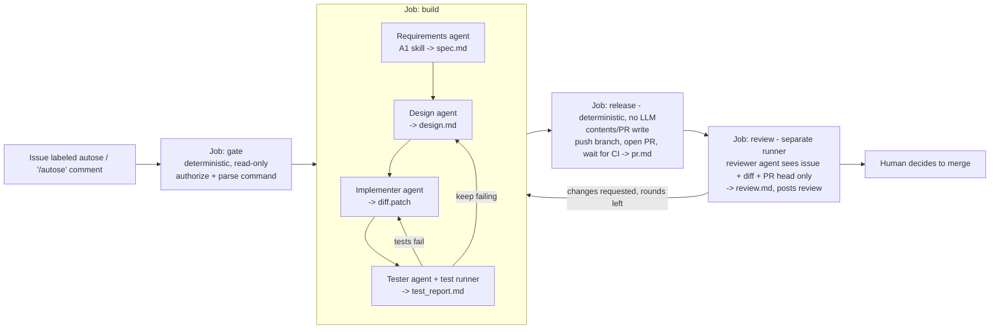

# AutoSE decision briefs (input for your ADRs, not the ADRs themselves)

Prepared with AI assistance on 2026-11-22. Each brief gives the problem, realistic options, trade-offs, a recommendation, and how the decision could be tested. **You make each decision.** The ADRs in `architecture/decisions/` record your choice and your reasons.

Facts relied on, all checked this session:
- `claude -p` denies non-approved tool calls in headless runs (Claude Code ≥ 2.1.302); `--permission-mode dontAsk` is documented for locked-down CI. Permission rules support `Edit(tests/**)` path patterns and `Bash(python -m unittest *)` prefixes, and deny beats allow (code.claude.com/docs permissions and headless pages).
- `GITHUB_TOKEN` is limited to the repository running the workflow. Events it creates don't start new workflow runs, except `workflow_dispatch`/`repository_dispatch`. PRs it opens get CI runs in an **approval-required** state (GitHub docs, "GITHUB_TOKEN").
- A PR's author cannot approve or request changes on their own PR (GitHub rule). The fork has "Allow GitHub Actions to create and approve pull requests" **off** (checked).
- `autose-a3` is **private**; the fork is public (checked). The Claude Pro token works in Actions via `CLAUDE_CODE_OAUTH_TOKEN` (claude-code-action docs).

---

## Proposed overall shape (if you accept the recommendations)

---

## D1 Splitting the work: how many agents?
**Problem.** Six fixed stages. One big agent mixes roles and context; one agent per stage maximises separation but adds hand-offs.

| Option | For | Against |
|---|---|---|
| A. One agent for all stages | Fewest hand-offs, shared context | Context grows huge; the agent "marks its own homework"; hard to give least privilege per stage; reviewer can't be independent |
| B. One agent per stage (6) | Clean separation | Release needs no judgement, and an LLM with push rights is a security risk |
| **C. Five LLM roles + deterministic Release (recommended)** | Requirements, Design, Implementer, Tester, Reviewer each get their own prompt, model settings and tools; the privileged Release step is plain code | More hand-offs to design (D3) |
| D. Merge Implementer and Tester | Cheaper | The implementer writes tests that confirm its own interpretation; weaker verification |

**Why C:** separation where judgement or independence matters (the tester checks the implementer; the reviewer checks everything); no LLM where only mechanics are needed (push, PR, CI polling).
**Test it:** variant "implementer writes its own tests" vs separate Tester, on the 5 issues; compare hidden-test pass rate and tokens.

### D1 research: other ways to combine the agents (read 2026-11-22)
Sources:
- **Course pattern catalogue:** [karthikv1392/autose-agent-patterns](https://github.com/karthikv1392/autose-agent-patterns), README and each pattern's `agent.py` docstring.
- **Anthropic, "Harness design for long-running application development"** (planner → generator ↔ evaluator).
- **Anthropic, "Building effective agents"** (prompt chaining with gates, evaluator-optimizer, orchestrator-workers, and others).

| Pattern (source) | What it is | Where it fits in AutoSE | Verdict |
|---|---|---|---|
| **Self-Reflection** (catalogue S3) | One agent: plan → critique its own plan → implement → test → diagnose failures → revise | Makes a *fair* single-agent baseline: one agent does stages 1–4 with forced self-critique checkpoints | Use as the single-agent variant |
| **Prompt chaining with gates** (Anthropic) | Fixed sequence of LLM steps with programmatic checks between them | Exactly the six stages with their checks | This is the role pipeline (option C) |
| **Generator–Critic / evaluator-optimizer** (catalogue M6, Anthropic) | A generator drafts; a separate critic scores against criteria and returns a must-fix list; loop until a gate passes | Already inside option C twice. (1) Implementer ⇄ Tester + real test run (a critic grounded in executed tests, which fixes the catalogue's warning about read-only critics). (2) The whole change ⇄ the independent Sonnet reviewer (must-fix list, ≤ 2 send-backs) | Keep, and name it in the ADR |
| **Planner → Generator ↔ Evaluator with a "contract"** (Anthropic harness) | Planner writes the spec; generator and evaluator agree on "what done looks like" before code is written; a sceptical evaluator grades | The spec's acceptance criteria are the contract; the Tester is the evaluator. A 3-role variant would merge Requirements + Design into one Planner | Possible third variant, if budget allows |
| **Debate** (catalogue M1) | Several reviewers (security, correctness, maintainer) argue; a judge decides | A stronger stage-6 reviewer | Good *reviewer* experiment variant |
| **Voting** (catalogue M2) | N independent candidate patches; pick by behavioural agreement | Implementation stage | Costly; the catalogue warns "agreement is not correctness" when errors are shared |
| **Swarm** (catalogue M4) | Agents name who acts next; no central controller | Conflicts with your D2 choice (code decides transitions) | Not used |
| **Sub-agent spawning** (catalogue M3) | Spawner creates one worker per module | Large refactors; our issues touch 1–3 files | Not used |
| **Human approval** (catalogue M7) | High-risk actions wait for a person | Already present: the human merge decision, maintainer answers (NEEDS_INPUT), and the diff guard that blocks changes to CI files | Name it in the safety ADR |

**Suggested way to test D1** (Anthropic's advice to remove one component at a time):
- the **role pipeline** (baseline), against
- a **single Self-Reflection agent** doing stages 1–4 in one context.

Both use the same deterministic checks, the same code Release, and the same independent Sonnet reviewer. The reviewer must stay separate in every variant, because the assignment requires it.
- *Optional third arm, if budget allows:* a Planner–Generator–Evaluator variant.

## D2 Control flow
**Problem.** Stages need loops (tests fail → implementation; repeated failures → design; review → design/implementation), bounded retries, and different permissions for different parts.

| Option | For | Against |
|---|---|---|
| A. Everything in one Actions job | Simple loops in code | One permission set for all; the reviewer would share a filesystem with the implementer |
| B. One Actions job per stage, chained with `needs` | Per-stage permissions, visible graph | Actions jobs can't loop |
| C. Workflows that dispatch each other | Unlimited loops | Hard to follow; state must cross runs |
| D. LLM planner decides the next step | Flexible | Non-deterministic control; easy to loop or skip checks |
| **E. Hybrid (recommended):** a deterministic Python state machine runs stages 1–4 *inside* one read-only job; Release and Review are separate jobs; review rounds are **unrolled** in the workflow graph (round 1, 2, 3) with conditions | Loops where they're needed, separate permissions where it matters, and the "at most twice" limit enforced by the graph itself | Longer workflow file (mitigated with a reusable workflow per round) |

**Who decides to go back:** code. Agents *report* (failing tests, or a reviewer verdict that names the stage to fix); the state machine applies fixed transition rules and budgets.
**Review rounds:** recommended literal reading of "at most twice": up to 2 send-backs, so at most 3 reviews.
**Test it:** count runs where loops fired, and whether bounds held (from `run_state.json`).

## D3 Hand-offs: what each agent receives
| Agent | Receives | Deliberately excluded |
|---|---|---|
| Requirements | issue text (as untrusted data), repository read-only | everything else |
| Design | issue, `spec.md`, `ARCHITECTURE.md`, repository | requirements agent's conversation |
| Implementer | `spec.md`, `design.md`, repository; on retry: failing-test excerpt; on rework: reviewer findings | spec/design agents' conversations |
| Tester | `spec.md` (acceptance criteria), repository with the change applied | implementer's reasoning, `design.md` reasoning |
| Reviewer | issue, diff, repository at PR head | `spec.md`, `design.md`, `test_report.md`, PR description, all agent conversations |

Full artifacts, not LLM summaries: they're short and structured, and summaries lose detail.
**How the Design agent gets `ARCHITECTURE.md`** (it lives in private `autose-a3`; the fork's token can't read that repo):
- **A (recommended):** a copy bundled with the agent code in the fork (e.g. `autose/context/ARCHITECTURE.md`), plus a sync script and a check that it matches `autose-a3`'s copy.
- **B:** a read token for `autose-a3` used by one deterministic step. But that token could also read the hidden tests, and a fine-grained token can't be limited to one file.
- **C:** paste it into the prompt at build time.

**Test it:** Design agent with vs without `ARCHITECTURE.md` (Experiment candidate E2).

## D4 State
- **Recommended:**
  - every stage writes its artifact plus `run_state.json` (stage, retries left, rounds, decisions) and `usage.json` (tokens) as workflow artifacts;
  - the PR branch holds **only code and tests**, because artifacts on the branch would leak reasoning to the reviewer;
  - one bot status comment on the issue links the run and records the run ID, so a later run can resume (e.g. after the maintainer answers questions);
  - branch `autose/issue-<n>`, one PR per issue, reused on reruns;
  - "Re-run failed jobs" reuses artifacts from jobs that succeeded.
- **Alternatives:**
  - files committed on the branch: simple, but breaks reviewer independence;
  - Actions cache: evictable, so not reliable;
  - PR comments only: hard to parse and visible to the reviewer.
- **Test it:** restart a failed run and check that it resumes from the right stage.

## D5 Tools and how they're provided
| Option | For | Against |
|---|---|---|
| A. `claude-code-action` (full) | Ready-made | Does its own GitHub operations with broad permissions; conflicts with keeping GitHub writes out of agents |
| B. `claude-code-base-action` | Thin official wrapper | One action call per step, so it can't loop inside our state machine |
| **C. Claude Code CLI (`claude -p`) called by our Python orchestrator (recommended)** | Full control of loops; per-role `--allowedTools`, deny rules, `--permission-mode dontAsk`, `--max-turns`, `--model`, `--effort`; JSON output with token usage | We maintain the orchestrator |
| D. Claude Agent SDK (Python) | Programmatic | More code, same engine; nothing gained for this deadline |
| E. GitHub MCP server for agents | Agents can act on GitHub | Far too much power for agents; rejected |

Per-role permissions (recommended):
- **Requirements, Design:** Read, Grep, Glob only.
- **Implementer:** plus Edit/Write limited to `markdown/**`, `tests/**`, `docs/changelog.md`, and Bash limited to compile and test commands.
- **Tester:** Edit/Write limited to `tests/**`, plus the test commands.
- **Reviewer:** read and run tests only; no edits, no git.
- **GitHub operations** (push, PR, comments, reviews): deterministic steps with the `gh` CLI and job-scoped tokens only.
- **A deterministic diff guard** rejects changes to `.github/`, `tox.ini`, agent code, or deleted tests.

**Test it:** injection test issues that try to make an agent edit workflows or print secrets; the attempt must be blocked and logged.

## D6 Models
**You asked for Sonnet or Haiku at medium effort.**
- **A (recommended):** Sonnet (medium) for all five roles. Roles differ by prompt, context and tools. Haiku is used as an *experiment variant*.
- **B:** Haiku for Requirements and Tester (cheaper, faster), Sonnet for Design, Implementer and Reviewer.
- **C:** Reviewer on a different model from the implementer, for diversity. But the only alternative is Haiku, which is weaker at finding bugs.

**Test it:** reviewer Sonnet vs Haiku on the seeded PRs (detection rate vs tokens).

## D7 Checks (who decides pass/fail)
The **orchestrator (code) makes every final decision**; LLM output is an input to it.

| Stage | Check (recommended) |
|---|---|
| 1 Requirements | Parse `spec.md` front matter; every AC has an ID, an input, a public call and an oracle kind; status from your skill's stage gate (PASS / NEEDS_INPUT / FAIL) |
| 2 Design | Parse `design.md`; every listed file exists (or is marked new); every listed function or class exists (Python AST); has an "ARCHITECTURE.md vs source" discrepancy section |
| 3 Implementation | Diff non-empty; diff guard; `pip install -e .`; compile all modules; import and convert smoke test; flake8 (the repo's own linter) |
| 4 Testing | Full `unittest` suite passes; every AC ID appears in at least one new test; new tests fail on the base commit for bug/feature ACs (no empty tests); test count not lower (same environment) |
| 5 Release | PR open via API; all CI check runs on the head commit succeed (timeout) |
| 6 Review | Structured verdict (approve / request changes + target stage + findings with evidence); round limit enforced by the graph |

**Test it:** stage pass rates per issue; reviewer findings that the checks missed.

## D8 Reviewer independence
How it's separated, all recommended together:
- its own job on a fresh runner;
- its own prompt (adversarial checklist: derive expectations from the issue alone, run the tests, probe edge cases, check for weakened tests);
- read-and-run permissions only;
- it never sees spec, design, test report or conversations;
- a structured verdict that must cite evidence.

**Who posts the review, and can it formally approve?** (This also decides how CI gets triggered; see D10.)

| Option | For | Against |
|---|---|---|
| **A. A GitHub App opens the PR; the reviewer posts with `GITHUB_TOKEN` (github-actions[bot]) (recommended)** | Two different identities, so real APPROVE / REQUEST_CHANGES reviews; PRs from an App trigger CI normally; short-lived tokens | You create and install an App on the fork (~15–20 min of clicks, guided), and we enable "Allow Actions to create and approve PRs" |
| B. Everything via `GITHUB_TOKEN`; review posted as a COMMENT with a verdict label | No setup | No formal approval; CI on bot PRs needs approval, so we'd add `workflow_dispatch` to upstream's CI file |
| C. Your personal access token opens the PR | Quick | Bot actions appear as you (confusing who did what); long-lived credential |

**Stopping "approve everything":** seeded PRs with known defects, an evidence-required verdict, and a report of the false-approval rate.
**Test it:** Experiment candidate E1 (reviewer variants on seeded PRs).

## D9 Safety and failures
**Recommended:**
- **Budgets:** `--max-turns` per role; `timeout-minutes` per step and job; implementer↔tester retries ≤ 2; tester→design escalation ≤ 1; review send-backs ≤ 2. Hitting a Pro usage limit fails the stage cleanly, with the reason in its artifact.
- **Untrusted input:** issue and comment text fetched by API into files, never `${{ }}` in shell; delimited in prompts as data; your skill's R4.
- **Least privilege:** agents get no GitHub write token. The Claude token exists only in agent steps, Bash is restricted to an allowlist, and the full test suite runs in a deterministic step with a cleaned environment.
- **Bot loops:** comments from bots are ignored.
- **Stuck stages:** a per-stage wall clock; then the artifact explains and the run stops.

**Test it:** one adversarial injection issue (extra evidence beyond the five).

## D10 Triggers, authorization, concurrency
**Recommended:**
- **Triggers:**
  - `issues: labeled` (only the `autose` label);
  - `issue_comment: created` with `/autose` from OWNER/MEMBER/COLLABORATOR only: on an issue it starts or resumes a run (answers go to spec update mode); on a PR it runs review only, which is also how the seeded PRs are reviewed;
  - `workflow_dispatch` (issue number, experiment variant) for development and experiments.
- **Concurrency:** group per issue (`autose-issue-<n>`), queued rather than cancelled; different issues run in parallel.
- **Branches and artifacts:** named per issue and run.

## Experiments (choose two ADRs to test)
| Candidate | Variants | Cost | Measures |
|---|---|---|---|
| **E1 Reviewer (D8 or D6) (recommended)** | A: reviewer runs code + adversarial checklist (Sonnet). B: read-only diff review, or Haiku reviewer | Low: review-only runs on 5 seeded PRs + 5 real PRs | Caught defects, false approvals, false rejections, tokens |
| **E2 ARCHITECTURE.md for Design (D3) (recommended)** | With (= baseline runs) vs without | 5 extra full runs | Design-check pass, constraint violations (e.g. missing changelog), hidden-test pass rate, tokens |
| E3 Separate Tester (D1) | Separate vs implementer writes tests | 5 extra full runs | Hidden-test pass rate, test quality |

**Run estimate with E1 + E2:** about 5 baseline runs (+1 if issue 5 asks questions), 5 E2 runs (+1), 10–20 review-only runs, and a few development runs. That's roughly 12–14 full pipeline runs. Tokens per run will be measured on the first real run, not guessed.
