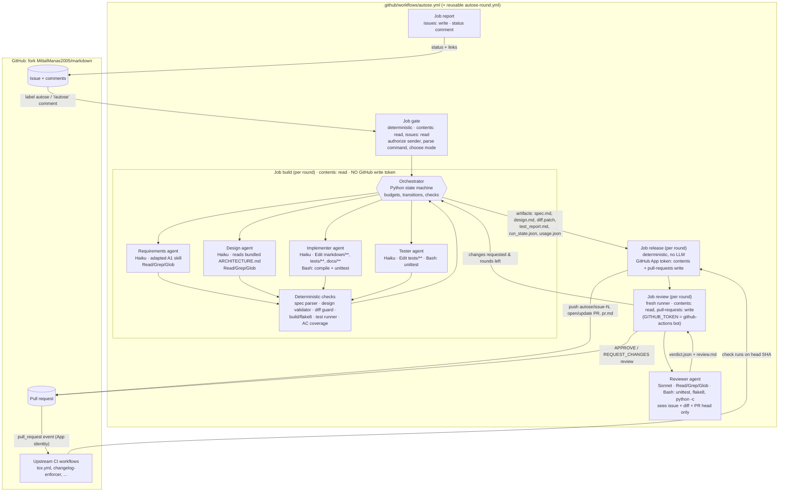

# Component view: AutoSE

Status: **design** (2026-11-22, before implementation). It describes the system as decided in ADR-001 … ADR-011 and is updated if an ADR is superseded.

Where things live:
- **Fork** [`MittalManas2005/markdown`](https://github.com/MittalManas2005/markdown): the workflow, the agent code and prompts, and a bundled copy of `ARCHITECTURE.md`.
- **Submission repository** `autose-a3` (private until grading): documentation, a copy of the workflow and agent code, issues, hidden tests, results.

## Diagram

## Components

| Component | Kind | Model / runtime | Tools and permissions | Produces |
|---|---|---|---|---|
| Gate job | deterministic | bash + `gh` | `contents: read`, `issues: read` | mode (`full`, `resume`, `review-only`), issue number, round settings |
| Orchestrator | deterministic | Python 3.12 | runs the agents through `claude -p`, runs the checks, applies the transition table and budgets | `run_state.json`, `usage.json`, stage artifacts |
| Requirements agent | LLM | Claude Haiku, effort medium | Read, Grep, Glob; follows the adapted A1 skill (`autose/skills/requirements-spec-builder.md`) | `spec.md` (PASS / NEEDS_INPUT / FAIL) |
| Design agent | LLM | Claude Haiku, effort medium | Read, Grep, Glob; reads `autose/context/ARCHITECTURE.md` | `design.md` |
| Implementer agent | LLM | Claude Haiku, effort medium | Read, Grep, Glob, Edit/Write limited to `markdown/**`, `tests/**`, `docs/**`; Bash limited to compile and test commands | working-tree change → `diff.patch` |
| Tester agent | LLM | Claude Haiku, effort medium | Read, Grep, Glob, Edit/Write limited to `tests/**`; Bash limited to test commands | AC tests (inside `diff.patch`), input to `test_report.md` |
| Checks | deterministic | Python | spec parser, design validator (AST), diff guard, build + flake8, `unittest` runner (clean environment), AC-coverage, fail-on-base | pass/fail + reasons into the stage artifacts |
| Release job | deterministic | bash + `gh` + GitHub App token | `contents: write`, `pull-requests: write` (App installation token, 1 h lifetime) | branch `autose/issue-N`, PR, `pr.md`, CI result |
| Review job | deterministic shell + LLM | — | `contents: read`, `pull-requests: write` via `GITHUB_TOKEN` | posts the review |
| Reviewer agent | LLM | Claude Sonnet, effort medium | Read, Grep, Glob; Bash limited to `python -m unittest`, `python -m flake8`, `python -c`; no edits, no git, no `gh` | `review.md`, `verdict.json`, session transcript |
| Report job | deterministic | `gh` | `issues: write` | one status comment on the issue with links and the run ID |
| Upstream CI | existing workflows in the fork | — | unchanged upstream configuration | check runs on the PR head commit |

## Interactions that are deliberately absent
- No agent receives a GitHub token with write access. All GitHub writes happen in deterministic steps (ADR-005, ADR-012).
- The review job never downloads build artifacts (`spec.md`, `design.md`, `test_report.md`) and never reads the PR description (ADR-003, ADR-013).
- No agent has web access, and no token in the fork can read `autose-a3`, where the hidden tests live (ADR-012).
- Commands an agent runs (tests, `python -c` probes) get no Claude credentials: Claude Code removes them from their environment (`CLAUDE_CODE_SUBPROCESS_ENV_SCRUB=1`, ADR-012). Each agent's session transcript is kept in its job's artifact.
